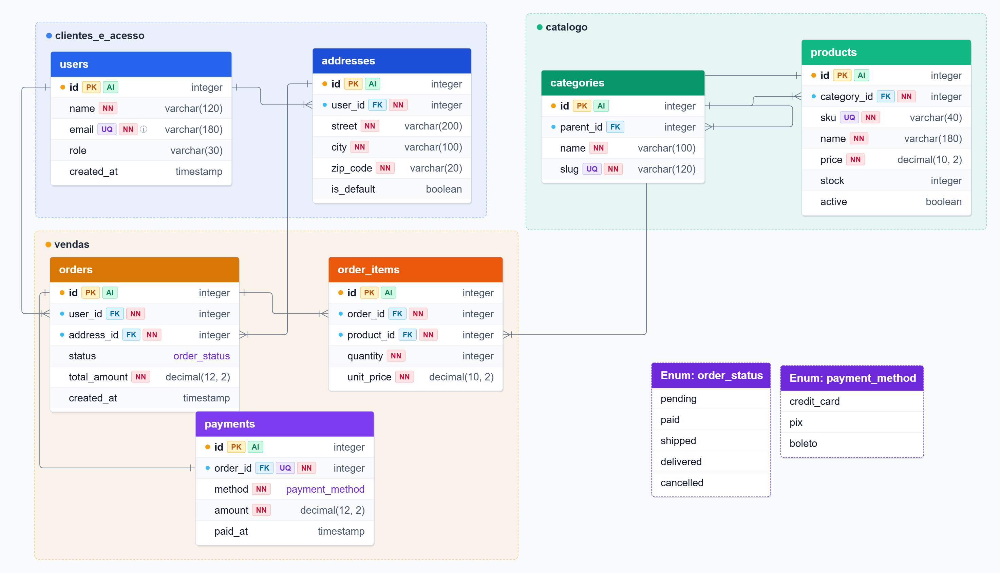

# DBDiagram OSS Studio

Um editor visual **100% open-source** de diagramas de banco de dados (ERD) baseado em **DBML (Database Markup Language)**, construído inteiramente em **HTML, CSS e JavaScript puro** (sem build, sem dependências externas, pronto para abrir localmente ou hospedar no **GitHub Pages**).

Inspirado no [dbdiagram.io](https://dbdiagram.io) e no [TruDan/dbdiagram-oss](https://github.com/TruDan/dbdiagram-oss), com foco especial em **controle preciso do tamanho da fonte na tela e em todas as exportações**.

---

## Principais Funcionalidades

- **Controle Exato de Fonte (Visualização + Exportação):**
  - Ajuste a fonte do diagrama de `8px` até `36px` diretamente na barra superior (`-` / `+` / valor numérico) ou no painel de **Tipografia** (slider, presets rápidos, família da fonte e escala do título).
  - As tabelas, colunas, badges e grupos (`TableGroup`) recalculam automaticamente largura, altura e âncoras das linhas via medição de texto real — **sem cortes ou sobreposição de texto**.
  - **SVG, PNG (1x 1:1 exato, 2x, 3x) e PDF** são exportados preservando exatamente o tamanho e a família de fonte selecionados.
- **Suporte Completo à Sintaxe DBML:**
  - `Table`, `Table ... as Alias`, `schema.table`, `[headercolor: #hex]`, `Note`, `Indexes`
  - Colunas com `[pk]`, `[primary key]`, `[not null]`, `[unique]`, `[increment]`, `[default: ...]`, `[note: '...']`, `[ref: > tabela.col]`
  - `Ref` standalone e composto (`Ref: a.(b, c) > d.(e, f)`), cardinalidades `>`, `<`, `-`, `<>` e ações `delete`/`update`
  - `Enum` com exibição opcional no diagrama
  - `TableGroup` com cor personalizada e movimentação em bloco (arraste o cabeçalho do grupo!)
- **Canvas Interativo:**
  - Pan, zoom centrado no cursor, ajustar à tela (`Fit`), busca rápida (`Ctrl+K`) e modo foco/tela cheia.
  - Arraste tabelas, enums, grupos ou ajuste manualmente o ponto médio das linhas de relacionamento (duplo clique reseta a rota).
  - Troca rápida de cor do cabeçalho direto no card da tabela (sincronizado com `[headercolor: #...]` no DBML).
  - Tema **Escuro** e **Claro**, além de seletor de idioma (**PT-BR / EN**).
- **Importação e Exportação:**
  - **Importar:** `.dbml`, `.sql` (PostgreSQL / MySQL / SQLite DDL -> DBML) e `.json` (salva também layout e tamanho da fonte).
  - **Exportar:** **PNG** (1x exato / 2x / 3x + fundo claro/escuro/transparente), **SVG** vetorial puro, **PDF** nativo, **SQL** (PostgreSQL, MySQL, SQLite), **DBML** e **JSON**.

---



## Como Usar

### Localmente
Não precisa instalar nada nem rodar servidor de build:
1. Clone ou baixe este repositório.
2. Abra o arquivo `index.html` diretamente no navegador (ou sirva com qualquer servidor estático, como `npx serve .` ou Live Server).

## Estrutura do Projeto

```text
dbdiagram-oss-web/
├── index.html            # Interface principal da aplicação
├── css/
│   └── styles.css        # Estilos (Dark/Light Mode, editor, modais e canvas)
├── js/
│   ├── i18n.js           # Traduções PT-BR / EN
│   ├── samples.js        # Schemas DBML de exemplo
│   ├── dbml-parser.js    # Parser completo DBML + formatador
│   ├── sql-converter.js  # Conversor SQL <-> DBML (PostgreSQL, MySQL, SQLite)
│   ├── layout-engine.js  # Medição dinâmica de texto e auto-layout
│   ├── renderer.js       # Renderizador SVG puro (tabelas, grupos, enums, crow's foot)
│   ├── exporter.js       # Exportação SVG, PNG, PDF (zero-dep), SQL, DBML e JSON
│   ├── editor.js         # Editor DBML com numeração de linhas, highlight e atalhos
│   └── app.js            # Estado global, persistência localStorage e eventos
├── LICENSE               # Licença MIT
└── README.md
```

---

## Licença

Distribuído sob a licença **MIT**. Veja [LICENSE](LICENSE) para mais detalhes.
